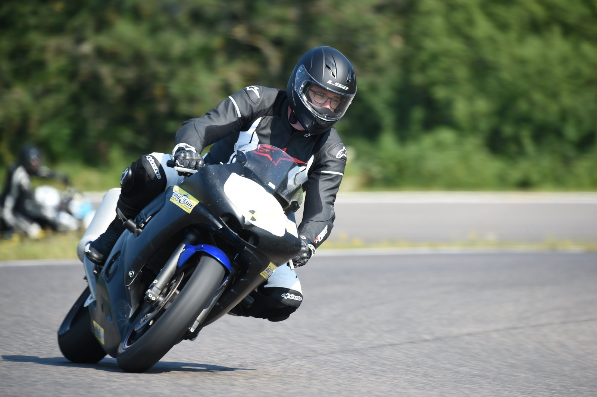
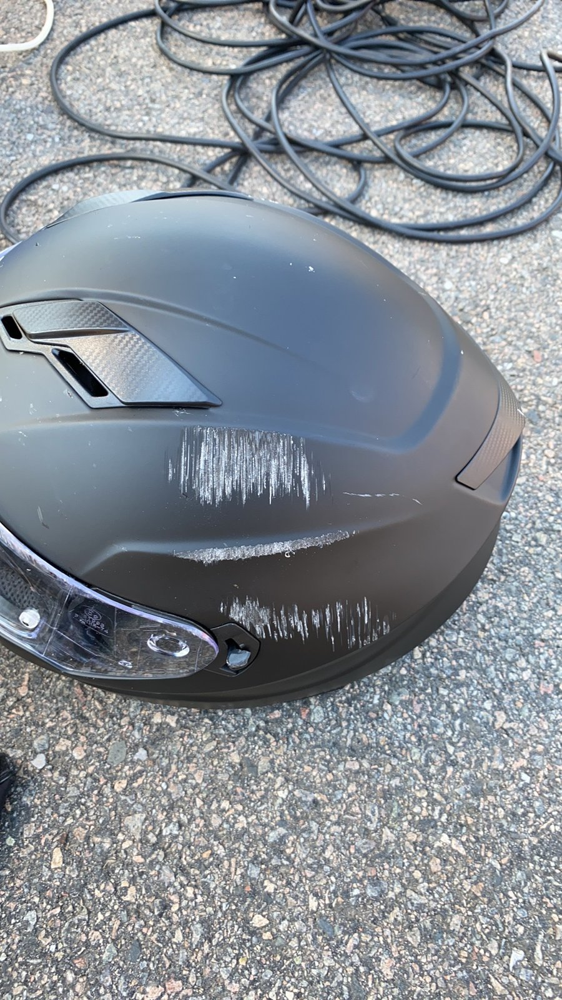
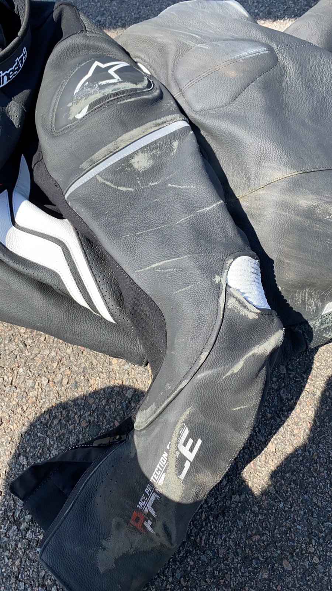
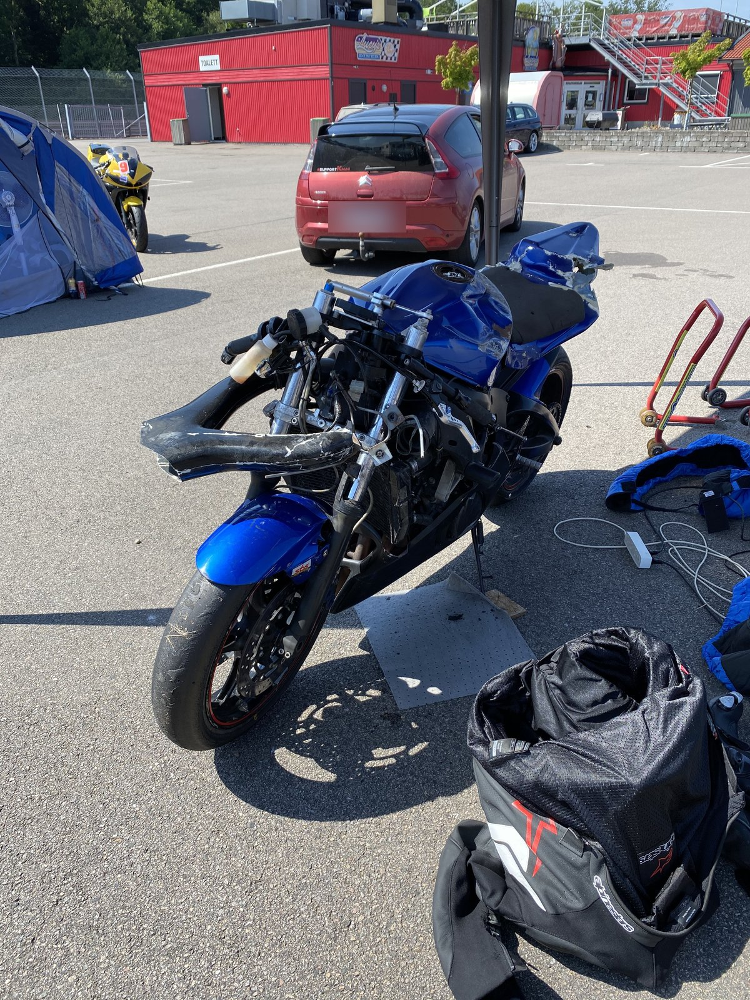
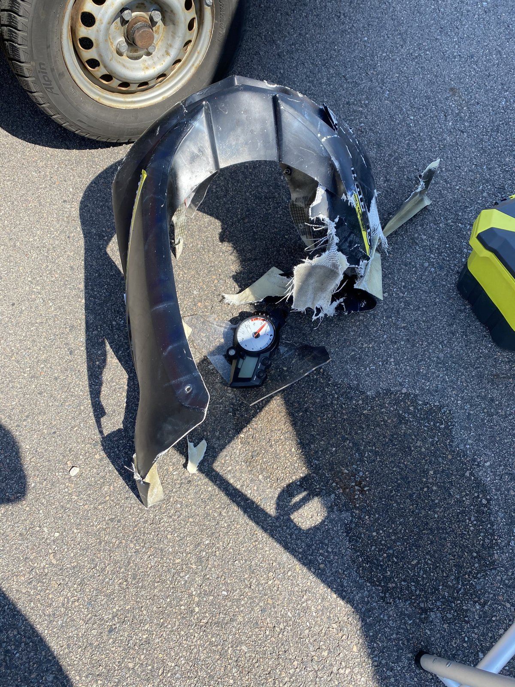

+++
date = '2026-11-25'
draft = false
title = "Oh wow, low-risk thrills! ... Till they aren't"
+++

*Photo: Morten Kimer / Kimers Foto*

My first motorcycle trackday felt like the safest place I'd ever ridden. On day two, I crashed.

Some years back, I'd done an instructor-led riding course on a racetrack and discovered it was probably the most fun I could have by myself. A bit of research and soul searching later, I'd bought a dedicated track bike and signed up for my first trackday.

Late on a Friday night, I drove to Ring Knutstorp in Sweden with the bike on my new-to-me trailer, having signed up for track riding on Saturday and Sunday. I set up camp when I got there, and next morning discovered I'd landed next to the nicest of neighbours. They answered all my beginner questions and were just as thrilled to be there as I was. I've since learned that all the neighbours are nice, and everybody is absolutely itching to be there. That's why we do it :-)

I'd never ridden the track before, but I'd watched a bunch of onboard videos on YouTube, so I at least knew where it went. I started in the beginners' sessions on the first day, then left them and went for it.

The. Best. Thrill. Ever.

And it felt totally safe. No trees, no oncoming traffic, and definitely no car drivers with their heads in their phones, passively trying to kill everybody around them. You could just go for it, to the best of your ability and courage. So I did.

I went quicker every session on the first day. Felt great. Saturday evening, I sat around with some of the other guys over a cold beer, swapping stories and soaking up the atmosphere.

Sunday morning, I was buzzing. First session, warming up. Second session, faster again. I couldn't wait for the third, or for the afternoon race, where I was definitely going to finish way further ahead than on Saturday. Cockiness had completely taken over.

Third session, first full lap. I came up behind a slower rider and thought, "I'll take him before the hairpin, there's lots of room." I set it up through the left-hander, went hard on the gas, and the next thing I knew, I was rolling on the asphalt at around 100 km/h, listening to my crash helmet save my head while my motorcycle made very expensive sounds in the background.

I don't know how many times I rolled. Everything went in slow motion, and I had a whole conversation with myself while waiting to be stationary: "I should remember to relax my body so it's more flexible. Oh crap, I don't like the sound my new helmet is making against the asphalt, it's going to be ruined. Hmm. I don't think I'm moving anymore. Better wait a second and check again. Nope, still not moving. Which means I'm lying on a racetrack. I should probably move. I wonder if I can."

That's not even the whole train of thought for those couple of seconds.

*Photo: Morten Kimer / Kimers Foto*

Physically, I was fine. Nothing broken, just shaken up, and the darkest bruises I've ever had, nigh on pitch black. They took a few weeks to stop hurting.

What happened?

Well, the rider I'd set up to overtake was already being overtaken by somebody else, which I'd missed. That pass was a bit tighter than he was comfortable with, so he moved over to make room, right in front of me. Entirely my own doing. On track, overtaking cleanly is your responsibility. The rider in front has no mirrors and just does his own thing.

The bike made a good winter project. I had to fix pretty much everything in front of and behind the engine. It made it back to the track the next season... and then I sold it and took a break from track riding for a while. It didn't feel safe anymore. I couldn't get into the zone for my own thoughts, so it felt even scarier than riding in traffic.

Getting my mojo back took a while, and real work.

I definitely hadn't seen the full risk. A racetrack is a safe place to go fast. That doesn't make it a place where mistakes have no consequences.
