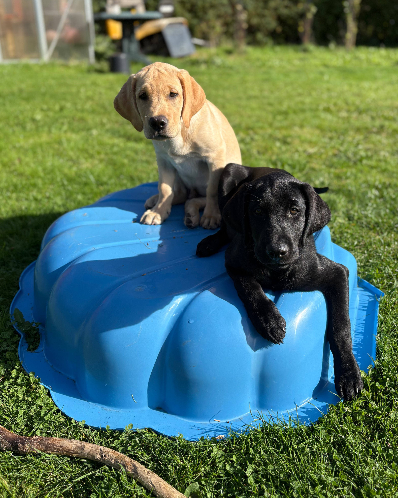

+++
date = '2026-11-26'
draft = false
title = "Mind the tail"
description = "Puppies don't know they have a back half, and neither do agents. Twice an enthusiastic helper knocked something over, and what I do now."
tags = ['ai-agents']
+++

Easily excitable, very keen, and with no idea that the back half gets a vote. Puppies and agents both.

Last week I wrote about [what we reward](https://tommyeriksen.dk/posts/whatever-you-reward/), and how two Labrador puppies made that very concrete.

You've heard about our puppy-and-human team coach. Official title: dog trainer. She's been in a lot of our conversations lately. Occasionally the dogs come up too.

## The back half

One of her points has stuck with me. A puppy isn't really aware of its own back half. If the front end fits through the gap, all is well. Whatever gets knocked over when it turns, or when the tail goes in pure enthusiasm, is collateral damage. And it's genuinely surprised every time. Where did that mug come from?

I know that surprise. I've had it twice recently, both times with an agent doing exactly what I asked.

## The ID card that only worked at the front door

First, I asked an agent to switch a database platform to a certain type of certificate: a sort of digital ID card systems show each other before they talk.

I thought it was straightforward, so it went fast. The agent did it in one pass and handed me a tidy summary as if the job were done.

The catch: this kind of ID card only works at the front door. Fine when a client logs in. But the database is several servers keeping copies of the same data in sync, which needs a different ID. The servers couldn't prove to each other who they were, so they dropped the connection, and the whole thing rolled over on its back and lay on the floor until we'd cleaned up.

The agent hadn't done anything wrong, exactly. It got the front end through the gap. I just hadn't asked what was behind it.

My call: too little perspective check, too much enthusiasm.

## The reviewer who invented paperwork

Second, I was automating a compliance process: fill out a form from a template using validated input, so nobody copies the same facts into the same boxes again. Very bleeding edge.

I wrote the skill, spelled out the logic, and the first pass looked fine. Then I thought, "I'd better do the adversarial agent thing", and set up a second agent to check the form against the template. A second pair of eyes, just without the coffee.

But I didn't tell it what the form was for, or what "complete" meant. So off it went, and before I knew it, it had pretty much invented two new document types and made them mandatory.

Tail, meet coffee table. Inventing extra paperwork wasn't really the point :-)

## Room to turn

In both cases my helpers were very enthusiastic. I just didn't think it through, or leave them room to turn around.

So now I try to build the turn in:

- Before it changes anything, I ask what else leans on it. Not "what does this change do?" but "who else will notice?"
- A reviewer gets told what the form is for, not just handed the template. Otherwise it helpfully finds things to add.
- If something feels straightforward, I slow down slightly. That's usually where I've stopped looking.

The enthusiasm can stay. I just need to remember the tail.
