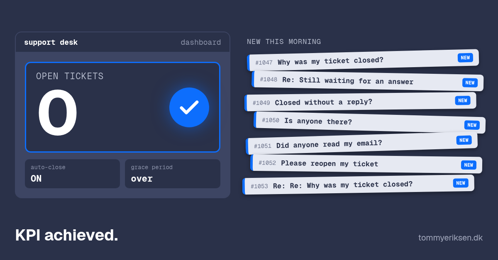

+++
date = '2026-10-28'
draft = false
title = "Why I'm suspicious of an empty queue"
tags = ['ways-of-working', 'leadership', 'lessons-learned']
images = ['empty-queue_wide.png']
+++

Many moons ago, I manned a support desk. I pretty much was the support desk.

The support desk was based on emails back then, which was nigh on unmanageable, so we invested in a ticketing system to help us track them.

After an especially busy period, there were a bunch of tickets which hadn't been answered for a while, so we were racking up open tickets overall.

"We shouldn't have so many open support tickets" became the internal KPI.

Lo and behold, it had a switch to auto-close tickets which hadn't been active for a bit (after a notice).

I activated it.

And one morning after the grace period, I clocked in at the office to a pile of new tickets asking why we'd closed the customers' old tickets without responding. Turns out the system didn't care if the ticket had been waiting for me or the customer.

But we did achieve the KPI: almost zero open tickets.

## What I took from it

The KPI wasn't daft. A pile of unanswered tickets is a real problem. The trouble started when the number became the thing to hit, because the quickest way to hit it was closing tickets, not answering them. Goodhart's law, apparently.

The system did exactly what I asked of it. It closed tickets that had gone quiet. It just couldn't tell a ticket waiting on the customer from one waiting on me. Neither could the KPI.

An empty queue looks a lot like happy customers. Sometimes it's just a queue that's been emptied.

I've been a bit suspicious of an empty queue ever since.
