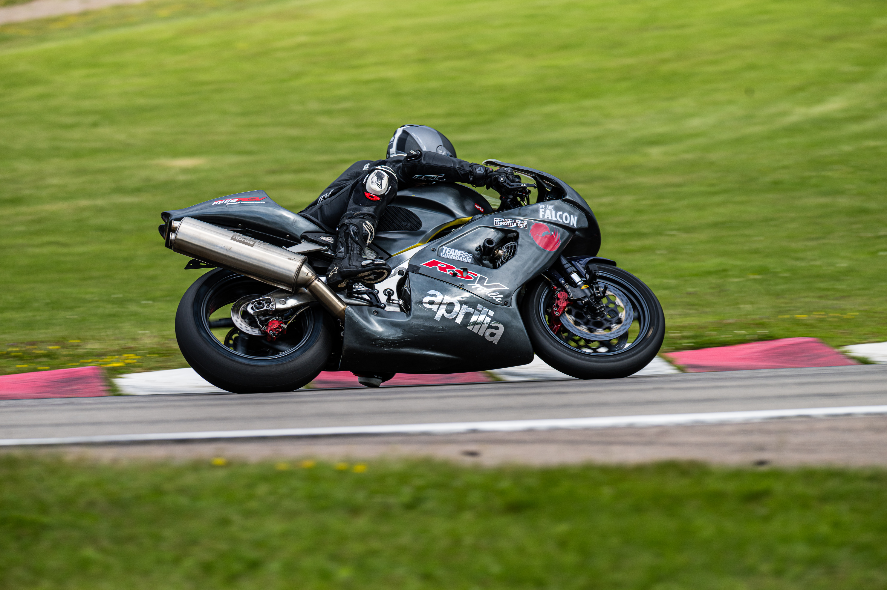

+++
date = '2026-10-29'
draft = false
title = "Ten seconds at a time"
tags = ['motorcycles']
images = ['DSC_7733_cover.jpg']
+++

*Foto: Morten Kimer / Kimers Foto*

Focus isn't thinking about everything. It's choosing what exists right now.

At work I live in long-term plans. Quarters, roadmaps, things that won't be finished until after next summer. On a racetrack, the world lasts about ten seconds.

That's roughly how far I can see through a corner. Where I look is where I end up. The next lap, the week, the inbox: none of it is there yet.

## It didn't click straight away

On my first riding course, the main feeling was "hah, how can this possibly be allowed". Once that wore off, something else took its place.

With speed you get a bit of tunnel vision on track, and you (hopefully) forget everything except what you can see. The braking marker, the turn-in point, the apex, the exit. Nothing else gets a vote.

Hopefully, because if you start thinking about tomorrow's special offers and what you want for your birthday, you've missed a braking point and a turn-in point in the meantime, and you're lying in the gravel trap.

Your view through the corner decides both how well and how fast you get through it. It also more or less defines what exists in your world at that moment.

That contrast with my working life is the main reason I ride.

## Free, and relatively safe

The track gives you a freedom the road never will. No oncoming traffic, no trees in the verge, no speed limits. And it's relatively safe, because everyone shares the same basic idea of what safe riding looks like.

That doesn't mean there are no consequences. On a motorcycle the risk is part of the experience, and there's no such thing as a mistake without a cost. Everyone agreeing on the rules is a good start, but you still need margin.

Last time, someone overtook me down the straight, pulled in ahead and braked earlier than I'd planned. I found my new maximum brake pressure, and a few choice words.

## Turning the volume down

I do a version of this away from the track too. When the noise is at its loudest, I turn down media in general and only engage with a few selected things.

I firmly believe humans aren't built to relate to everything, all the time. It's about being able to filter. That isn't the same as not caring. It's deciding what you can actually do something about right now.

Long-term plans still matter, and I'd be a poor planner without them. They just aren't what gets you through the corner.
