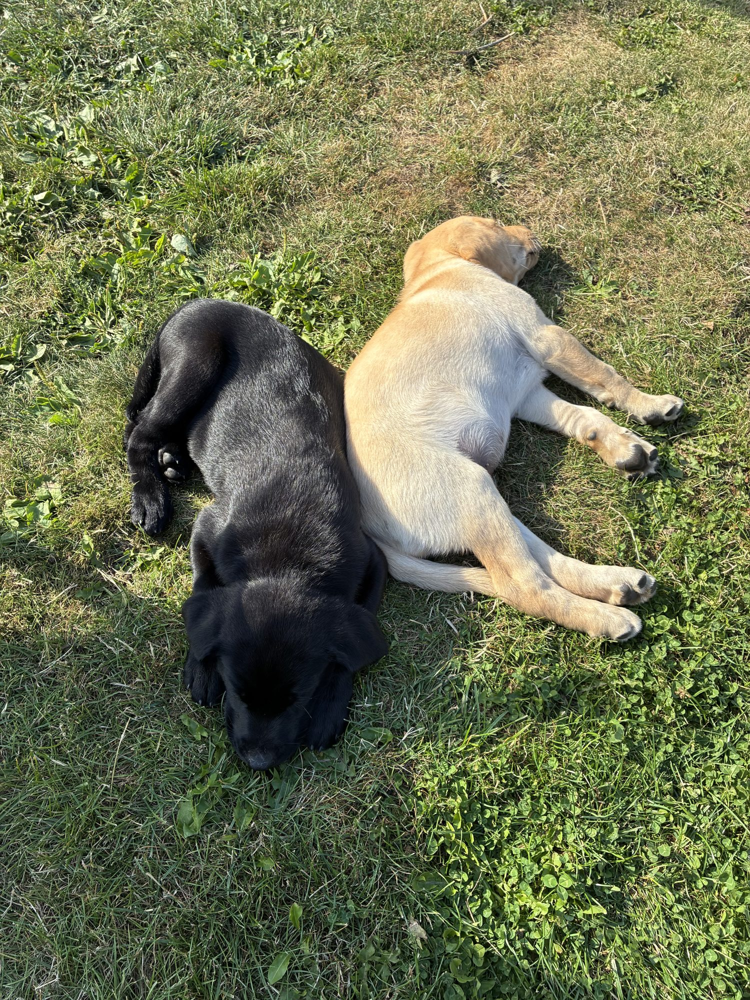
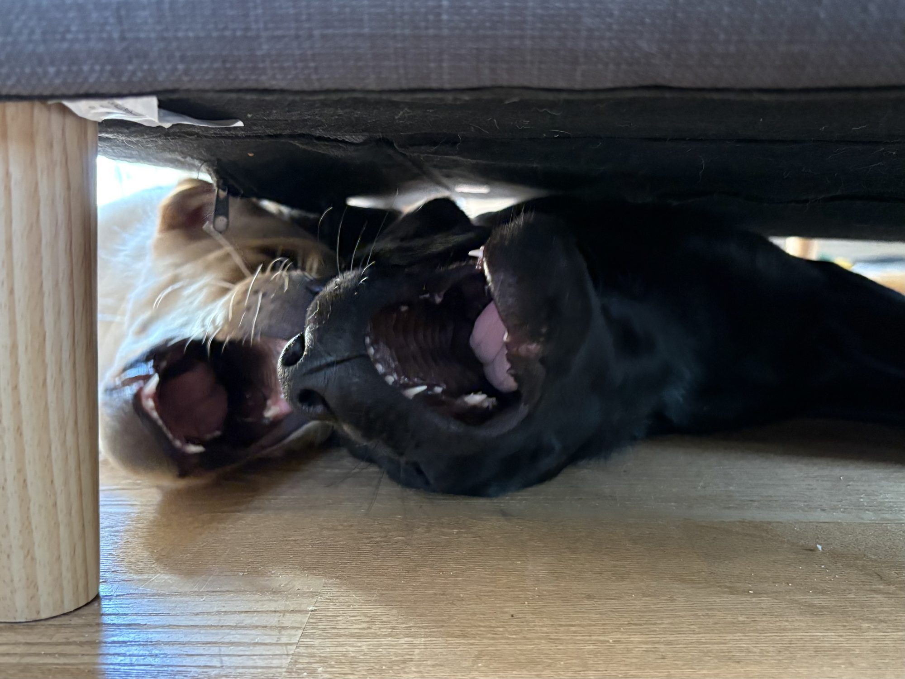

+++
date = '2026-11-19'
draft = false
title = "Whatever you reward, you get more of"
description = "Two puppies, a dog trainer and a lot of treats. What they taught me about KPIs: whatever you reward, you get more of."
tags = ['platform', 'leadership']
+++

Whatever you reward, you get more of. We got two Labrador puppies at once, and it turns out we've been doing agile at home.

Picture one: two puppies asleep in a heap. Picture two: the same two, heads under the sofa, biting at something nobody else can see. Both are the result of rewards.

With Labradors, the reward is easy to pick. It's always food and praise, and they love both. Roughly equally, depending on how close to dinner it is.

Two at once takes work, so we brought in a dog trainer. Which, as far as I can tell, is a team coach for dog families. Together we worked out what our KPIs and OKRs should look like, and when they should pay out.

One of the puppy OKRs was called "Recall" and looked something like: When I call out to the puppy, it should come back to me.

And on that OKR, our trainer had notes. Exactly when the treat lands decides what you end up with: a dog that wants to come back, or a dog that takes all the time in the world to finish its own task first. Reward at the wrong moment, and you've paid for the sniffing.

Looking back, we did most of the playbook:

- aligned with the stakeholder's perspective, which happens to be a dog's
- took the helicopter view of where we wanted their development to go. Basically a roadmap
- split the training into shorter periods. Sprints, if you like
- pivoted several times, as the boys found new ways to explore their surroundings
- onboarded family and friends on the new rules of collaboration

The buzzwords are a joke. The point underneath isn't: whatever you reward, you get more of.

A friend saw the work version too. A KPI capped the number of open major incidents. Once the cap was hit, new ones simply stopped being logged as major incidents and got handled without the proper procedures. Management got its KPI. The people doing the work got messier operations and longer outages.

Puppies don't read the OKR. They do what pays. Teams aren't that different. They're just more polite about it.
